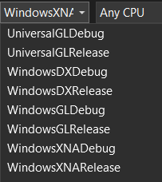
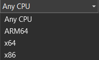
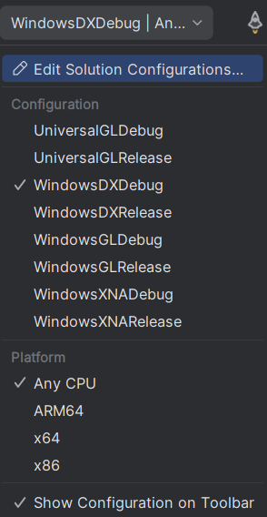

# 构建与发布

以下内容描述默认构建脚本（Build.ps1）执行的步骤。

## 引擎配置

客户端使用不同的 API 进行渲染，这些 API 称为引擎（Engine）。引擎定义了所使用的技术以及客户端可以运行的平台：

任意平台（Windows、Linux、macOS）：
* UniversalGL

仅 Windows：
* WindowsDX
* WindowsGL
* WindowsXNA

## TargetFramework 配置

每个引擎配置会构建一个或多个 TargetFramework：

UniversalGL：
* net8.0

WindowsDX、WindowsGL 与 WindowsXNA：
* net4.8

各引擎配置的差异概览：

| 配置 | 操作系统支持 | 默认平台 | 技术 |
| ------------- | ---------- | ---------------- | ----------------------------- |
| UniversalGL   | 任意        | AnyCPU           | MonoGame DesktopGL            |
| WindowsDX     | Windows    | AnyCPU           | MonoGame WindowsDX + WinForms |
| WindowsGL     | Windows    | AnyCPU           | MonoGame DesktopGL + WinForms |
| WindowsXNA    | Windows    | x86              | Microsoft XNA + WinForms      |

## 构建输出

使用 `dotnet publish` 命令时，构建输出会创建在 `\Compiled` 目录中。

启动客户端的方式例如：`dotnet clientogl.dll`

## 不使用 IDE 构建

要在不使用 Visual Studio 的情况下构建客户端，请安装 .NET 8.0 SDK、PowerShell 7.0，然后运行 `Script\Build.bat`。编译结果会放到仓库根目录的 `Compiled` 文件夹。

## 使用 Visual Studio 构建

> [!IMPORTANT]
> IDE 可以构建 Release 配置，但由于编译期优化，禁止直接运行这些二进制文件。

你可以直接从解决方案配置中选择所需的配置：

注意 XNA 配置只能以 `x86` 构建/调试。

> [!WARNING]
> 在 Visual Studio 中更改解决方案配置后，你*必须*在项目根目录通过 cmd/PowerShell 手动执行 `dotnet restore` 以加载包，并重启 Visual Studio，以避免 [NETSDK1004](https://learn.microsoft.com/en-us/dotnet/core/tools/sdk-errors/netsdk1004) 与 [NETSDK1005](https://learn.microsoft.com/en-us/dotnet/core/tools/sdk-errors/netsdk1005) 错误。

## 使用 Rider 构建

从顶部面板的列表中选择所需配置：

