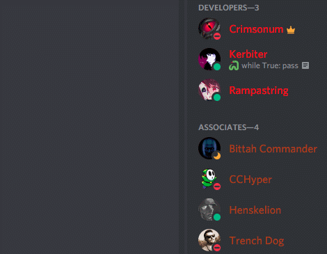
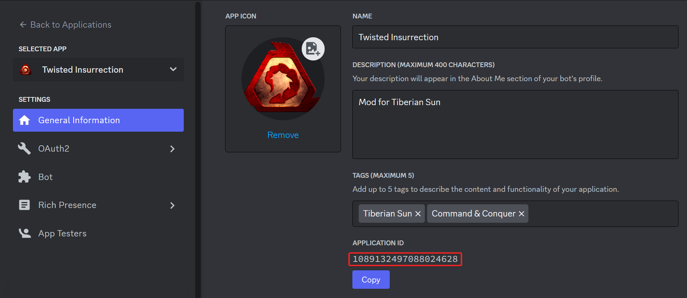
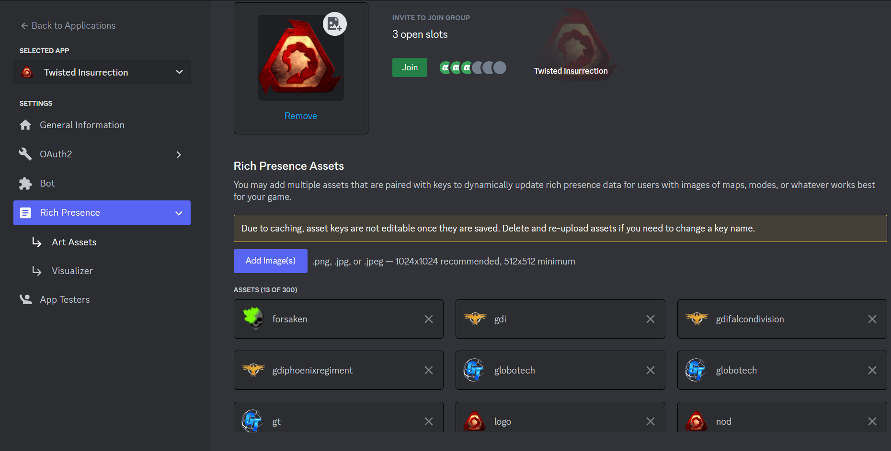

# XNA CnCNet 客户端的 Discord Rich Presence 支持

## 关于 Discord Rich Presence

Discord Rich Presence（DRP）是一项实用功能，允许 Discord 用户向其他用户展示当前正在进行的游戏或应用的详细信息。借助 DRP，现有玩家可以向好友展示自己的活动，并扩大你的模组/游戏的知名度，从而提升人气。

客户端会根据当前用户的活动显示大厅类型、名称、地图/任务名、游戏模式、玩家数量、可用槽位、玩家是否在游戏中、已用时间、玩家阵营等信息。

只要你按以下步骤为你的模组/游戏设置 presence，XNA 客户端就支持显示针对你的模组/游戏定制的 DRP 信息。

## 如何为你的模组/游戏设置 DRP

> [!NOTE]
> 你必须登录 Discord 账号。

1. 打开 [Discord 开发者门户](https://discord.com/developers/applications)。
2. 点击 `New Application` 按钮，输入你的模组名称，勾选同意 Discord 政策的 "policy" 复选框，然后点击 `Create`。
3. 在应用的 `General Information` 标签页中可以找到 `Application ID`。将其填入 `Resource/ClientDefinitions.ini` → `[Settings]` → `DiscordAppId` 键。

4. 在 `Rich Presence` → `Art Assets` 标签页中，通过 `Add Image(s)` 按钮上传客户端/模组标志与阵营图标。上传的图片命名应如下：
   - **游戏/模组标志** 在应用资源中命名为 `logo`（在 Discord *application info* 中添加应用图片**并不相同**，不会显示在用户的浮窗中）；
   - **阵营、随机选择器与旁观者图标** 的名称只能包含小写字母与数字（必须能通过 [RegExp](https://regexr.com) `[a-z]|[0-9]` 校验）。需使用*未本地化*的名称，转为小写并移除非字母数字字符。例如：
     - `Nod Genesis Legion` → `nodgenesislegion`，
     - `Yuri's Legi0n` → `yurislegi0n`，
     - `Random Allies` → `randomallies`，
     - `Spectator` → `spectator` 等。

   上传图片后，点击 `Save Changes` 按钮。

> [!NOTE]
> Discord 更新应用信息或资源可能需要一些时间。如果你在运行客户端时修改了资源与应用信息，若未立即生效，请尝试重启 Discord 和/或客户端。
